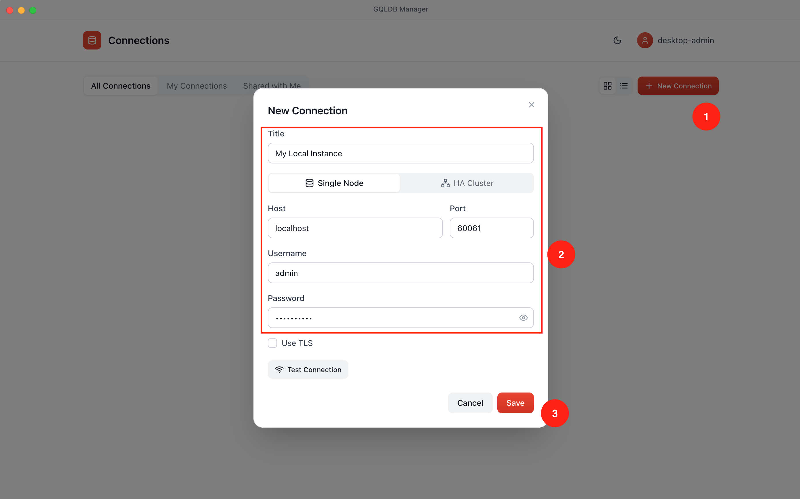
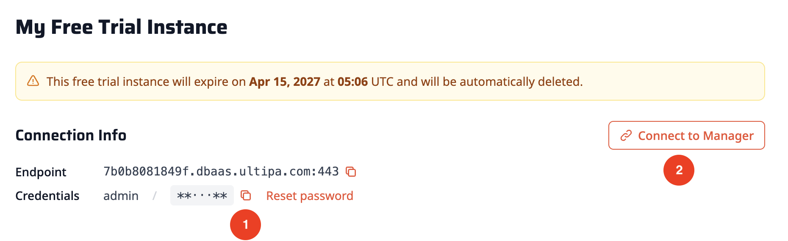
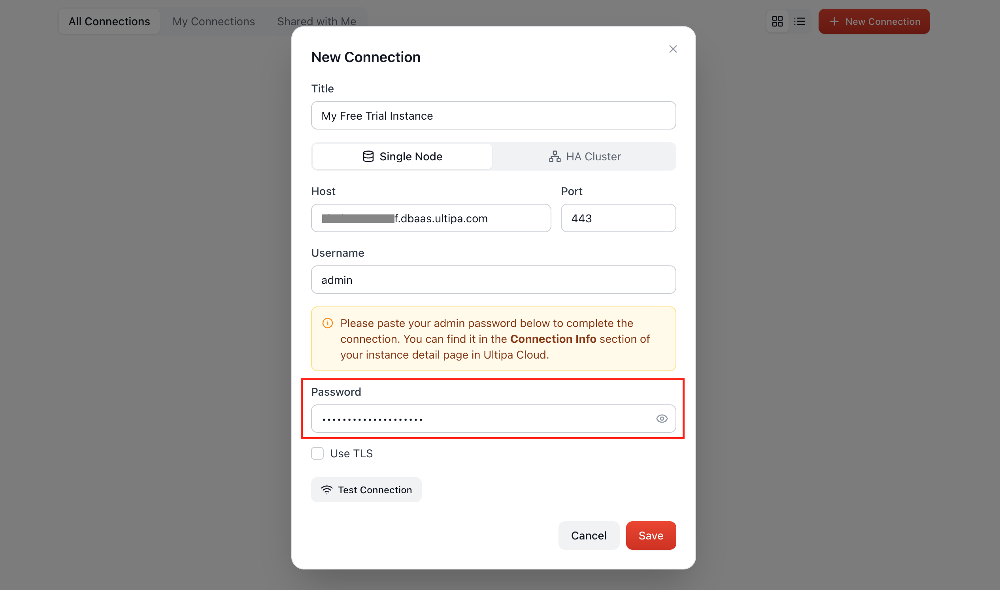
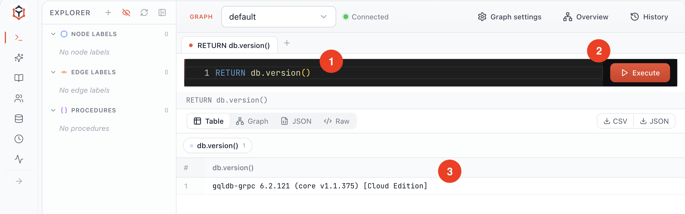

# 1. Install & Connect

There are two paths to spin up a GQLDB instance:

- **[Run locally](#Option-A-Run-Locally)**: A database running on your machine, on macOS, Linux, or Windows.
- **[Ultipa Cloud](#Option-B-Ultipa-Cloud)**: A fully-managed database with nothing to install.

However you launched it, you can connect to it with **Ultipa Manager**, a visual tool for managing your database and running queries, or with the **Ultipa CLI**, a command-line client.

## Option A: Run Locally

Open your terminal and run the GQLDB installer for your platform.

**macOS / Linux** (in a terminal):

```bash
curl -fsSL https://download.ultipa.com/gqldb/install.sh | sh
```

**Windows 10/11** (in PowerShell):

```powershell
irm https://download.ultipa.com/gqldb/install.ps1 | iex
```

Then verify the installation:

```bash
ultipa-gqldb -version
```

On macOS, if the first run fails with a Gatekeeper quarantine error, clear the attribute: `xattr -d com.apple.quarantine "$(command -v ultipa-gqldb)" 2>/dev/null`

Create a database:

```bash
# Create a project directory and enter it
mkdir my-gqldb
cd my-gqldb

# Create a database
ultipa-gqldb -db ./my.gdb -rbac -admin-pass myPassword -port 60061
```

The database instance immediately runs on `localhost:60061`. It runs in the foreground, so its logs stream in this terminal, that is normal and means the server is up. Keep this terminal open (closing it, or pressing Ctrl+C, stops the server). To keep it running in the background instead, launch it with `nohup`.

A few things worth knowing:

- The data directory is created as `my.gdb` in your current folder.
- The admin credential is created as `admin` / `myPassword`.
- No license file is needed. The database is initialized with a `default` graph, and you may create one more graph. Each graph has up to 1M nodes and 1M edges, plenty for most demo projects.

To connect to the database and run queries with a visual tool, download the **GQLDB Manager** desktop app from the <a href="/download" target="_blank">Download Center</a>, choosing the build for your platform (macOS, Linux, or Windows). Open it, add a new connection to your local instance with host `localhost`, port `60061`, and the `admin` / `myPassword` credentials, then save and open the connection.

On macOS, the desktop app is not yet notarized, so the first launch may be blocked by Gatekeeper (a "GQLDB Manager" can't be opened / is damaged message). Right-click the app in **Applications** and choose **Open**, then confirm; or clear the quarantine attribute from a terminal: `xattr -dr com.apple.quarantine "/Applications/GQLDB Manager.app"`.

<center></center>

The desktop app has to run on your own machine, beside the database. The Manager that Ultipa Cloud opens in your browser runs on Ultipa's servers: it is that server, not your browser, that dials the database, so a `localhost` connection added there points at the cloud machine rather than at yours. A local instance needs the desktop app.

Alternatively, use the <a href="/docs/tools/cli" target="_blank">Ultipa CLI</a>, available from the same Download Center for macOS, Linux, and Windows:

```bash
gqldb-cli -h localhost:60061 -u admin -p myPassword -g default
```

That opens an interactive shell. Every GQL statement in this and the following chapters runs in it unchanged.

## Option B: Ultipa Cloud

Create a fully-managed GQLDB instance on Ultipa Cloud, with nothing to install:

1. In a browser, open <a href="https://dbaas.ultipa.com" target="_blank">Ultipa Cloud</a>, sign in or create an account.
2. From the Dashboard, click **Create instance**. New accounts get a free trial, selected by default, so just confirm to create it.
3. Wait until the instance status shows **RUNNING**.
4. Click **Details** to see the instance endpoint (`xxx.dbaas.ultipa.com:443`) and credentials (`admin` and a password you can copy) under **Connection Info**.

<center></center>

Copy the password and click **Connect to Manager**; Ultipa Manager opens in a new tab. The first time, you will be prompted to add the connection. All fields are auto-filled except the password, paste it and click **Save**:

<center></center>

You will see the connection card added, with a green status indicator next to the connection name. Click the card to enter the connection.

## Run Your First Query

In Manager's query editor, or in the CLI shell, run the following GQL statement to check your database version:

```gql
RETURN db.version()
```

<center></center>

---

You have a running instance and a client that can reach it. Next, put some data in it: <a href="/docs/quick-start/load-data" target="_blank">Load Your Data</a>.
